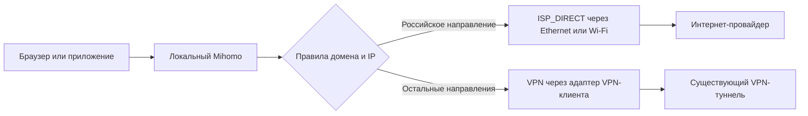

# Установка на компьютере получателя

## Результат и область применения

Итоговая цепочка выглядит так.



Основной сценарий использует уже установленный отдельный VPN и Mihomo как локальный маршрутизатор HTTP/SOCKS. В этой конфигурации `tun.enable` выключен. DNS и IPv4 настроены в самом ядре для запросов через его прокси. Исходные системные маршруты и сетевые адаптеры сохраняются.

Системный прокси не охватывает произвольный UDP, программы со своим сетевым стеком и приложения, игнорирующие его настройки. Для таких программ используй их собственный HTTP/SOCKS-прокси. Полный системный TUN требует отдельного проектирования взаимодействия с существующим VPN.

Поддерживаемые условия следующие.

- Windows 10/11, PowerShell 7.2 или новее, доступные команды NetTCPIP и NetAdapter.
- Подключённый VPN с отдельным интерфейсом Windows и работающим выходом через него.
- Физический Ethernet или Wi-Fi с прямым выходом через провайдера.
- Разрешённые на ПК операции установки и пользовательского автозапуска.

Если VPN работает только как расширение браузера, выход `type: direct` через VPN-адаптер применить нельзя. При обнаруженном локальном HTTP/SOCKS-порту VPN адаптируй выход `VPN` под этот порт по документации используемого клиента. Если у получателя есть собственная совместимая подписка Clash, существующий узел может играть роль выхода `VPN`. Подписку и её секреты используй только на ПК получателя.

## Подготовка и локальные пути

Распакуй архив. Папка навыка может лежать в произвольном месте. Сначала найди её по `SKILL.md` и `scripts/New-RoutingConfig.ps1`, затем создай переменную `$kit` с абсолютным путём к ней.

Дальше в примерах `$kit` уже обозначает найденную папку навыка. Все остальные значения вычисляются на целевом компьютере.

```powershell
$runtime = Join-Path $env:LOCALAPPDATA 'VpnSplitRouting'
$scripts = Join-Path $runtime 'scripts'
$bin = Join-Path $runtime 'bin'
$data = Join-Path $runtime 'data'
$settings = Join-Path $data 'routing-settings.json'
$taskName = 'VPN Split Routing'

New-Item -ItemType Directory -Path $runtime,$scripts,$bin -Force | Out-Null
Copy-Item -LiteralPath (Join-Path $kit 'scripts/Get-NetworkSnapshot.ps1') -Destination $scripts
Copy-Item -LiteralPath (Join-Path $kit 'scripts/New-RoutingConfig.ps1') -Destination $scripts
Copy-Item -LiteralPath (Join-Path $kit 'scripts/Watch-Routing.ps1') -Destination $scripts
Copy-Item -LiteralPath (Join-Path $kit 'scripts/Manage-SystemProxy.ps1') -Destination $scripts
Copy-Item -LiteralPath (Join-Path $kit 'scripts/verify_egress.py') -Destination $scripts
```

При повторной установке сначала проверь существующие файлы и задачу. Если это прежняя установка данного комплекта, используй её состояние и резервные копии. Для иной установки создай отдельную папку и выбери свободный порт. Изменение уже настроенных ключей и профилей для повторной установки не требуется.

В Windows PowerShell 5.1 сначала найди `pwsh.exe`. Если PowerShell 7 отсутствует, используй официальный пакет Microsoft.PowerShell через доступный на ПК установщик или Microsoft Store. Установку нового программного обеспечения выполняй в рамках полномочий агента. Нужные команды должны исполняться в PowerShell 7. Указание `#requires` в скриптах проверяет версию.

Если Windows пометила загруженный архив как полученный из интернета, после проверки источника и содержимого используй `Unblock-File -LiteralPath` для этого архива перед распаковкой либо для отдельных проверенных скриптов. Действующая корпоративная политика подписи может требовать подписанных скриптов. Постоянная смена политики выполнения всего компьютера для данного комплекта не требуется.

## Определение физических и VPN-интерфейсов

Подключи существующий VPN. Выполни команду и сохрани отчёт локально.

```powershell
$snapshotFile = Join-Path $runtime 'network-snapshot.json'
& (Join-Path $kit 'scripts/Get-NetworkSnapshot.ps1') -OutputFile $snapshotFile
$network = Get-Content -LiteralPath $snapshotFile -Raw | ConvertFrom-Json
```

Скрипт собирает псевдонимы адаптеров, их индексы, признак физического устройства, состояния IPv4, метрики и наличие основных маршрутов. Публичные адреса и секреты в вывод не включаются. Псевдонимы и описания устройств могут быть индивидуальными, поэтому этот отчёт хранится локально.

`suggested_physical` — активный физический адаптер с основным шлюзом и наименьшей метрикой интерфейса. При Ethernet и Wi-Fi одновременно учитывай фактическое подключение и сумму метрик маршрута и интерфейса. Сопоставь `vpn_candidates` с интерфейсом используемого VPN. Само наличие виртуального адаптера не доказывает VPN. Проверь маршруты `0.0.0.0/0`, `0.0.0.0/1` и `128.0.0.0/1`, а также `effective_public_routes`.

Если кандидатов несколько, сопоставь их с запущенным клиентом VPN, описанием драйвера и маршрутами. Выбери по фактическому выходу из раздела проверки. Когда право подключения уже дано, обычное подключение существующего VPN агент выполняет самостоятельно доступным штатным способом. Отсутствующие пароль, MFA или подписку вводит владелец.

Создай переменные по найденным значениям. В этом месте примера агент уже должен выбрать соответствующие псевдонимы из отчёта.

```powershell
$directAlias = $network.suggested_physical
# При одном подтверждённом VPN-кандидате выбирается он.
# При нескольких агент сначала сопоставляет маршруты и проверяет выходы.
if ($network.vpn_candidates.Count -eq 1) {
    $vpnAlias = $network.vpn_candidates[0]
}
if (!$directAlias -or !$vpnAlias -or $directAlias -eq $vpnAlias) {
    throw 'Сначала определить разные физический и VPN-интерфейсы по локальным данным'
}

$occupied = @(Get-NetTCPConnection -State Listen | Select-Object -ExpandProperty LocalPort -Unique)
$proxyPort = 7897..7997 | Where-Object { $_ -notin $occupied } | Select-Object -First 1
if (!$proxyPort) { throw 'В диапазоне не найден свободный порт' }
```

Имена интерфейсов не переводятся и не заменяются стандартными `Ethernet`/`Wi-Fi` по предположению. После переподключения VPN псевдоним может сохраниться, а индекс измениться. Конфигурация ядра использует псевдоним. Индексы для диагностического Python-скрипта вычисляй заново.

## Получение ядра и проверка источника

Найди существующий исполняемый файл Mihomo или ядро Clash Verge Rev. Если подходящего файла нет, скачай текущий стабильный релиз с официального GitHub проекта. Для x64 с неизвестным набором инструкций процессора выбери совместимую сборку Windows amd64. ARM64 требует своей сборки. Сохрани фактический тег, URL, архитектуру и SHA-256 в локальный отчёт. При опубликованном хеше или поле `digest` релизного файла сравни его с загруженными байтами. При отсутствии опубликованного хеша собственная сумма фиксирует полученный файл для повторного контроля, а происхождение устанавливается первичным HTTPS-источником.

Распакуй бинарный файл как `$bin/mihomo.exe`. Сами бинарные файлы в комплект не вложены. Архитектура, версии и лицензии определяются при установке. Страница релизов может измениться после даты подготовки архива. [Релизы Mihomo](https://github.com/MetaCubeX/mihomo/releases/latest)

```powershell
$core = Join-Path $bin 'mihomo.exe'
if (!(Test-Path -LiteralPath $core -PathType Leaf)) { throw 'Сначала получить проверенное ядро' }
& $core -v
Get-FileHash -LiteralPath $core -Algorithm SHA256
```

Запрос к API релизов и скачивание можно делать через уже работающий VPN или существующий прокси. Сначала загрузи инструменты, затем меняй системный прокси. Это сохраняет рабочую связь во время установки.

## Политика сайтов

Отредактируй копию `assets/routing-policy.json` под задачу владельца. Начальные правила включают `.ru`, `.рф`, Авито и его `avito.st`, Яндекс и основные его домены `.net`/`.com`, Банк Точка. Имена здесь публичные. Проверяй дополнительные домены по реальным запросам нужного приложения.

Приоритет правил такой.

1. Локальная сеть и loopback.
2. Явные домены `vpn_domain_suffixes`.
3. Явные прямые домены и российские доменные зоны.
4. Набор российских доменов.
5. Набор российских IP-сетей.
6. Остальной трафик через `VPN`.

`vpn_domain_suffixes` позволяет оставить конкретный сервис в VPN, даже если он входит в российский набор или доменную зону. Правило суффикса включает поддомены. Указание URL, пути страницы, порта или `*.domain` вместо обычного суффикса генератор отклонит. Порядок правил определяет первое срабатывание. [Правила Mihomo](https://wiki.metacubex.one/en/config/rules/)

Наборы `category-ru.mrs` и `geoip/ru.mrs` загружаются с публичного репозитория MetaCubeX, обновляются раз в сутки и кешируются в каталоге данных. Включённый набор IP отправляет напрямую любой домен с IP из российских сетей. При иной цели выключи `use_russian_ip_provider`. Владелец может оставить только домены и явные исключения. Поля провайдера `behavior` и `format` должны соответствовать файлу. [Наборы правил Mihomo](https://wiki.metacubex.one/en/config/rule-providers/)

## Создание и запуск конфигурации

```powershell
$policy = Join-Path $kit 'assets/routing-policy.json'
& (Join-Path $kit 'scripts/New-RoutingConfig.ps1') `
    -PhysicalInterface $directAlias -VpnInterface $vpnAlias `
    -CoreExe $core -DestinationDirectory $data -Port $proxyPort -PolicyFile $policy

$config = Join-Path $data 'config.yaml'
& $core -t -d $data -f $config
if ($LASTEXITCODE -ne 0) { throw 'Исправить конфигурацию до запуска' }
```

Генератор создаёт `config.yaml` и `routing-settings.json`, используя абсолютные пути данного ПК. `config.yaml` сериализован как JSON, что является допустимым YAML-документом и надёжно сохраняет кавычки и Unicode. Для ручного редактирования в графическом клиенте доступен обычный YAML-шаблон из `assets`. Выходы используют `interface-name` и `ip-version: ipv4`. [Прямой выход Mihomo](https://wiki.metacubex.one/en/config/proxies/direct/)

При первом запуске с наборами правил нужен доступ к публичным источникам. Если загрузка временно недоступна, скачай те же публичные файлы доступным соединением и проверь их загрузку ядром. Параметр генератора `-WithoutProviders` предназначен для диагностики схемы с явными доменами и зонами. Укажи сокращённый охват в отчёте, если временно использовал этот режим.

```powershell
& (Join-Path $scripts 'Watch-Routing.ps1') -SettingsFile $settings -Once
Start-Sleep -Seconds 2
& (Join-Path $scripts 'Watch-Routing.ps1') -SettingsFile $settings -CheckOnly
```

Ожидается `listener_ready: true`, один собственный процесс и оба адаптера `up`. Скрипт запускает ядро скрыто. Слушатель привязывается к loopback. Порт управления ядром по умолчанию не создаётся.

DNS проксируемых запросов обрабатывает Mihomo. Общие DoH-запросы направлены через `VPN`, повторное разрешение для прямых TCP-соединений — через `ISP_DIRECT`. Эти параметры не изменяют системные DNS-настройки и не являются проверкой всего DNS-трафика других приложений. [DNS Mihomo](https://wiki.metacubex.one/en/config/dns/)

## Системный прокси и отдельные приложения

После проверки слушателя выполни настройку текущего пользователя.

```powershell
& (Join-Path $scripts 'Manage-SystemProxy.ps1') -Action Apply -SettingsFile $settings
```

Скрипт сохранит исходные `ProxyEnable`, `ProxyServer`, `ProxyOverride` в `system-proxy-before.json`, затем задаст `127.0.0.1:$proxyPort` и уведомит WinINet. Если на ПК есть PAC, он остановится до изменения настроек. Агент должен установить, кто управляет PAC, и выполнить совместимую миграцию в рамках полномочий. Применение прокси к компьютеру с управляемой политикой может требовать действий администратора.

Проверь Windows → Сеть и Интернет → Прокси. Активный ручной адрес должен совпадать с локальным Mihomo. Учитывай автоматическую конфигурацию и WPAD, если они присутствуют. Настройки WinHTTP и переменные `HTTP_PROXY`/`HTTPS_PROXY` имеют отдельную область действия. Для установки браузерного разделения менять WinHTTP всего компьютера обычно не требуется.

Обычные Edge/Chrome обычно используют системный прокси. Для фонового Edge задай явный `--proxy-server=http://127.0.0.1:PORT`. В Яндекс Диске и приложениях с собственными настройками выбери системный прокси либо укажи локальный адрес и порт. Конкретный пункт определяется версией программы. Подробная проверка приведена в `verification.md`.

## Автозапуск после входа

Этот раздел относится к отдельному ядру под управлением `Watch-Routing.ps1`. Если ядром уже управляет Clash Verge Rev, используй его автозапуск и проверяй единственность владельца порта.

Сохрани скрипты в устойчивом локальном каталоге до создания задачи. Путь к папке Downloads или распакованному временному архиву для задачи не подходит.

```powershell
$pwsh = (Get-Command pwsh.exe -ErrorAction Stop).Source
$watcher = Join-Path $scripts 'Watch-Routing.ps1'
$watchArgs = '-NoProfile -NonInteractive -WindowStyle Hidden -File "' + $watcher + '" -SettingsFile "' + $settings + '"'
$action = New-ScheduledTaskAction -Execute $pwsh -Argument $watchArgs -WorkingDirectory $runtime
$account = [Security.Principal.WindowsIdentity]::GetCurrent().Name
$trigger = New-ScheduledTaskTrigger -AtLogOn -User $account
$retry = New-ScheduledTaskTrigger -Once -At (Get-Date).AddMinutes(1) `
    -RepetitionInterval (New-TimeSpan -Minutes 1)
$options = New-ScheduledTaskSettingsSet -MultipleInstances IgnoreNew `
    -ExecutionTimeLimit ([TimeSpan]::Zero) -StartWhenAvailable `
    -AllowStartIfOnBatteries -DontStopIfGoingOnBatteries
$principal = New-ScheduledTaskPrincipal -UserId $account -LogonType Interactive -RunLevel Limited
$existing = Get-ScheduledTask -TaskName $taskName -ErrorAction SilentlyContinue
if ($existing) { throw 'Сначала сверить владельца и команду существующей задачи' }
Register-ScheduledTask -TaskName $taskName -Action $action -Trigger @($trigger,$retry) `
    -Settings $options -Principal $principal | Out-Null
Start-ScheduledTask -TaskName $taskName
```

Настрой штатный запуск и автоматическое соединение уже имеющегося VPN-клиента. Порядок процессов Windows может различаться. Супервизор ждёт готовность двух адаптеров. Его задача перезапускается раз в минуту при завершении, а собственный mutex защищает от дублей. Он проверяет владельца порта и поднимает упавшее ядро. Состояние `CORE_STARTING_OR_UNHEALTHY` требует диагностики, если процесс жив, а слушатель долго не появляется. Скрипт намеренно ограничивает автоматическое восстановление запуском отсутствующего процесса.

Если регистрация задачи запрещена для данного аккаунта, используй штатную папку автозагрузки пользователя с ярлыком на ту же скрытую команду PowerShell. Это обеспечивает запуск при входе, но требует дополнительной проверки восстановления после аварии супервизора. Зафиксируй фактически выбранный механизм.

Системный прокси сохраняется в Windows. До запуска ядра приложения могут временно не иметь доступа к сети. Это учитывается при проверке времени восстановления. После смены Wi-Fi, переименования адаптера или установки другого VPN проверь привязки повторно.

## Если уже установлен Clash Verge Rev

Предпочти существующую исправную установку клиента, если она даёт оба нужных выхода и устойчивый автозапуск. Открой локальные профили и импортируй заполненный `mihomo.template.yaml` либо сгенерированную конфигурацию. Клиент копирует импортируемый файл в свой каталог профилей, поэтому дальнейшее редактирование исходной копии может не менять активный профиль. [Локальные профили Clash Verge Rev](https://www.clashverge.dev/guide/profile.html)

Выбери `Rule`/«Правила». Выключи TUN для этой схемы и проверь в итоговой конфигурации реальный порт, `interface-name` обоих выходов и порядок правил. Включи системный прокси и штатный автозапуск клиента. Клиент может добавлять свои глобальные поля и правила поверх профиля. Проверяй итоговую конфигурацию и журнал соединений. Наличие импортированного профиля само по себе не подтверждает применение.

Если установленный клиент конфликтует с отдельным TUN-VPN или постоянно меняет привязки, используй отдельное ядро этого комплекта. Оставь один компонент владельцем выбранного порта и системного прокси. Параллельные супервизор и клиент для одного порта создают конфликт. [Clash Verge Rev](https://github.com/clash-verge-rev/clash-verge-rev/releases/latest)

## Эксплуатация

Для обычной работы включён существующий VPN и локальный маршрутизатор. Российские сайты автоматически выбирают прямой выход. Подключать и отключать VPN перед посещением разных сайтов не нужно. Программа без поддержки системного прокси настраивается отдельно.

Чтобы вернуться к исходному интернету при выключенном VPN, восстанови сохранённый системный прокси и индивидуальные настройки приложений из раздела отката. Остановка ядра при оставшемся локальном прокси приводит к недоступности сети в использующих его приложениях.

Сведения об успешном подключении показывай после реальной проверки. Обещание постоянной доступности невозможно проверить одним запуском, поэтому фиксируй дату, время восстановления, проверенные сайты и механизмы восстановления.
